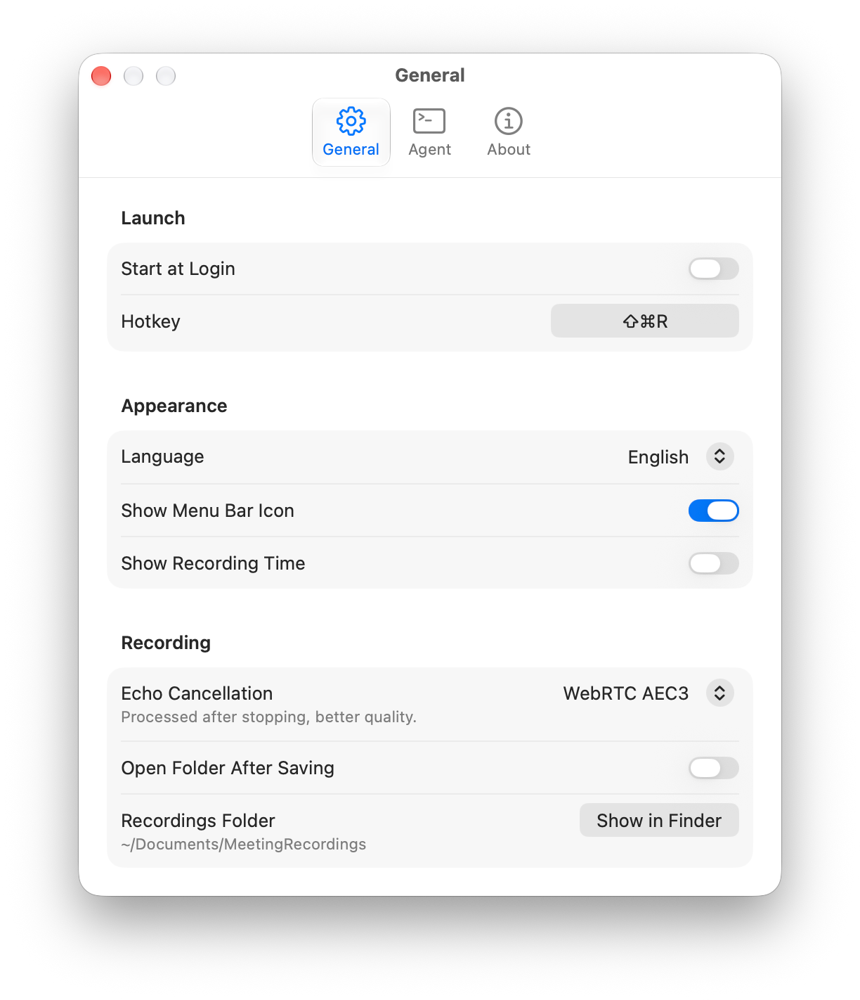

<p align="center">
  
</p>

<h1 align="center">Meep</h1>

<p align="center">A macOS menu bar app that records your meetings.</p>

<p align="center">
  
</p>

## Features

- Records both sides of any call (Zoom, Meet, Teams, a browser tab…) with no extra audio drivers
- Removes speaker echo, so you can take calls without headphones
- Keeps recording when you plug in or unplug headphones
- One-click start/stop from the menu bar, or a global hotkey (⌃⌘R)
- Scriptable: start and stop from the Terminal, Shortcuts or an AI agent

## Install

Requires macOS 15+ on Apple Silicon.

```bash
brew trust --cask cross-entropy-ai/tap/meep    # Homebrew asks you to trust casks from other taps once
brew install --cask cross-entropy-ai/tap/meep
```

This installs `Meep.app` into `/Applications` and the `meep` command (see [Automation](#automation)). Upgrade with `brew upgrade --cask meep`, or download the zip from [Releases](https://github.com/cross-entropy-ai/meep/releases).

The first time you record, macOS asks for **Microphone** and **System Audio Recording** access. Allow both.

## Automation

```bash
meep start --wait    # start recording, print the recording folder
meep stop --wait     # stop, return once the recording is saved
meep status          # JSON: idle / recording / saving
meep help            # all commands and settings
```

**Run After Saving** (Preferences › Agent) runs a command after each recording, e.g. a transcription script, with the recording folder as `$1`.

## License

[MIT](LICENSE). Echo cancellation uses [webrtc-audio-processing](https://gitlab.freedesktop.org/pulseaudio/webrtc-audio-processing) (BSD); icons from [Tabler Icons](https://tabler.io/icons) (MIT).

The app bundles [FFmpeg](https://ffmpeg.org) (LGPL-2.1) as a separate helper, `Contents/Helpers/ffmpeg`, for mixing. It is built from unmodified source by `scripts/build-ffmpeg.sh`, which records the exact configure line in `Contents/Resources/ffmpeg/BUILDINFO` next to the license; see [ffmpeg.org/legal.html](https://ffmpeg.org/legal.html).
